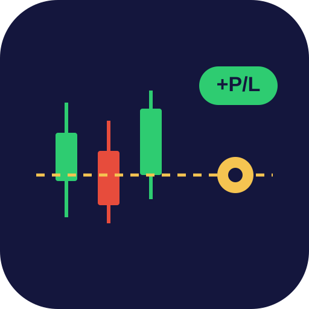
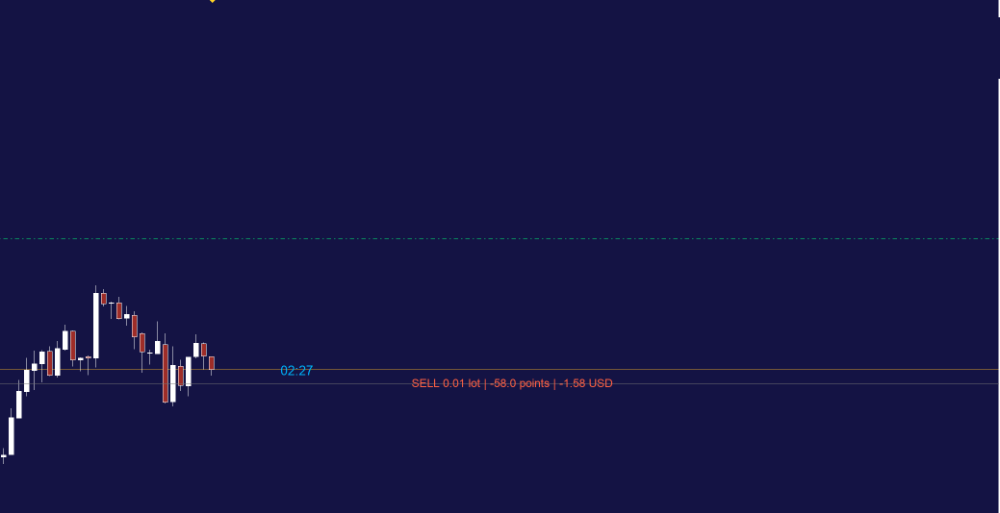

# Order Point P/L

A lightweight MetaTrader 5 chart indicator. It shows the live result of every open position directly on the chart, along with a compact account panel and a candle close countdown.

## Files
- `Profits.ex5`: compiled indicator for MetaTrader 5 (no source code in this repo)

## Screenshot

## Installation
1. Copy `Profits.ex5` to `MQL5/Indicators` in your MetaTrader 5 data folder.
2. Restart MetaTrader 5 or refresh the Navigator.
3. Drag the indicator onto a chart.

Requires MetaTrader 5.

## Product page
https://www.mql5.com/en/market/product/204481
